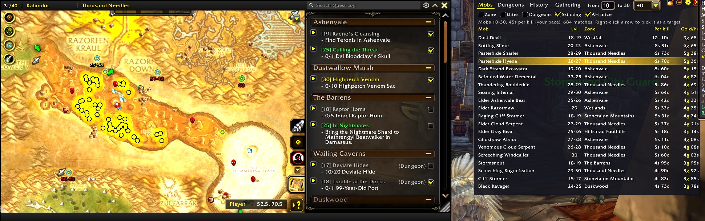
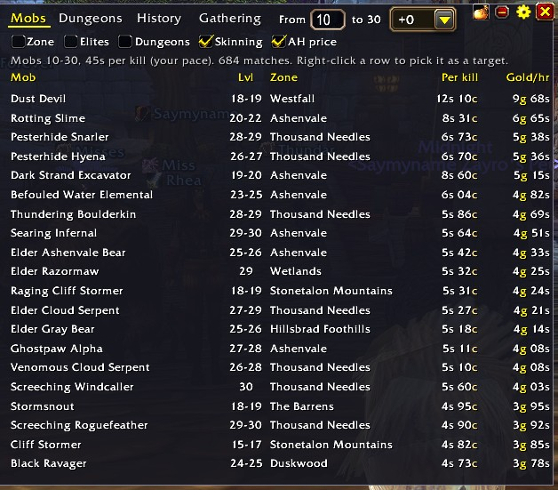
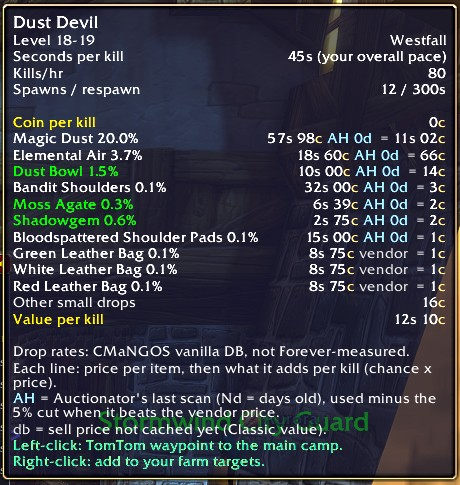
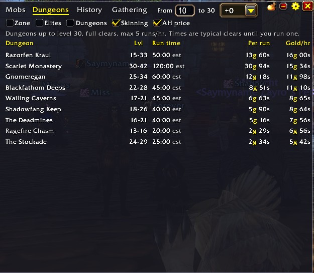
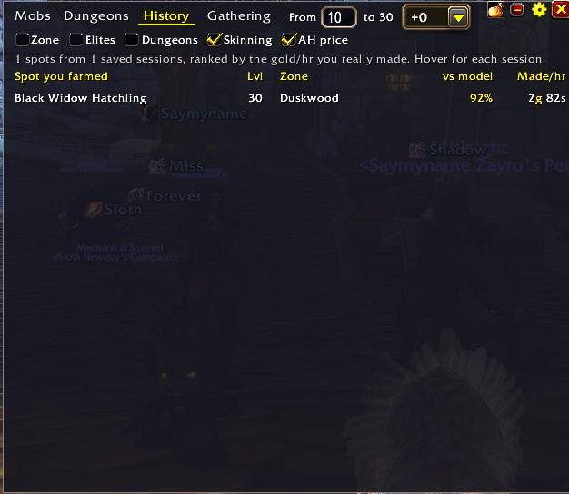
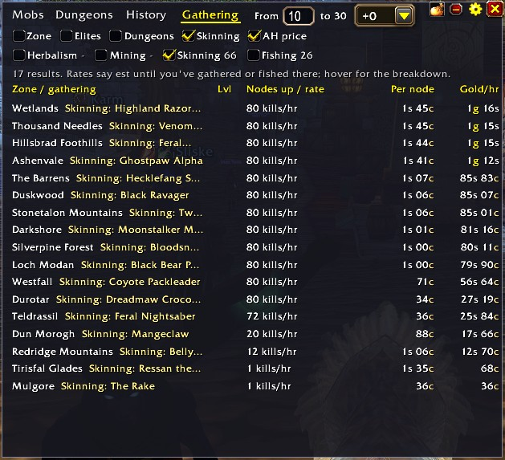
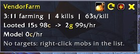

# VendorFarm 2.1.0

Find the best gold per hour for your level in WoW Forever. VendorFarm ranks the mobs, dungeons and gathering spots around your level by expected gold per hour. It starts from real drop-rate data and learns from every kill, node and catch you make.

    gold/hr = (average coin + drop chance x price of every drop) x kills per hour

### Mobs
Every mob in your level range, ranked by gold per hour. Hover a row for every drop, its chance, its price (vendor or Auctionator, with the scan's age) and what it adds per kill.

| Mob list | Drop tooltip |
|---|---|
|  |  |

### Dungeons, History and Gathering
| Dungeons | History |
|---|---|
|  |  |

### Compact tracker

## Features
- **Mobs tab**: every mob in your level range, ranked by gold/hr. Set the range with the *From* box and a +0 to +5 dropdown. Toggles cover your current zone only, elites, dungeon mobs, skinning loot and Auctionator prices.
- **Click a row** for a TomTom arrow to the mob's main camp, and click again to remove it. **Right-click** to make it a farm target: targets stay on top, show their combined gold/hr, and get **spawn dots on the world map and minimap**. Hovering a row with the world map open lights up that mob's spawns.
- **Dungeons tab**: every 5-man ranked by gold per full clear and per hour, with the 5-instances-an-hour cap. Your own runs replace the estimates.
- **Gathering tab**: Herbalism, Mining, Skinning and Fishing checkboxes, with your skill shown. Herb and ore nodes are ranked by zone, counting only nodes your skill can gather, along with the best fishing zones and skinnable mobs.
- **History tab**: every farm session is saved (when you end it, or after 15 minutes without a kill). The spots you farmed are ranked by the gold/hr you really made, next to what the model predicted.
- **Compact tracker** (`/vfarm track`): session time, kills, pace, gold looted and gold/hr, and "luck" against the model. Hover each line for the breakdown, such as coin vs. items, and vendor vs. AH totals.
- **Nearest vendor button** (the bag icon): left-click for an arrow to the nearest friendly vendor, right-click for the nearest one that repairs.
- **Minimap button**, plus a broker launcher for Titan, ChocolateBar and others.

## It learns as you play
- **Kill speed**: seconds per kill is learned overall and for each mob. Gaps over 3 minutes count as breaks. Elites get their own learned multiplier.
- **Drop rates**: every corpse you loot is recorded. Your rates blend in and fully take over after 100 kills (you can change that in options). Mobs missing from the database show up once you've killed them. A green dot means your data, a blue dot means other players' data.
- **Gathering**: nodes per hour and what nodes actually drop are learned for each zone, and the same goes for fishing.
- **Shared, all inside the game**: VendorFarm users share kill, loot and gathering totals through hidden addon messages (guild, party/raid and a hidden channel). Each player counts for a limited amount and impossible numbers are thrown out. You can turn it off in options.

## Install
Download `VendorFarm-<version>.zip` from the latest [release](../../releases/latest) and extract it into `World of Warcraft\_forever_\Interface\AddOns`, so you have `AddOns\VendorFarm\VendorFarm.toc`.

Works on its own. Recommended: **QuestieDB** (zones, spawn locations, friendly-NPC filter), **TomTom** (waypoints and spawn dots), **Auctionator** (AH prices).

## Commands
- `/vfarm` opens the list for your level. `/vfarm 32` checks another level.
- `/vfarm dungeons`, `/vfarm gathering` and `/vfarm history` open a tab.
- `/vfarm track` shows the compact tracker. `/vfarm minimap` shows or hides the minimap button. `/vfarm options` opens settings.
- `/vfarm vendor` and `/vfarm repair` drop an arrow to the nearest vendor.
- `/vfarm sync` shows the community data status.
- `/vfarm resetdata` clears your recorded kills. `/vfarm clearhistory` clears saved sessions.
- `/vfarm debug` toggles debug printing, and `/vfarm check` shows what this client supports. Include both in bug reports.

## Where the numbers come from
- **Other players (1.6.0+):** VendorFarm users share kill/loot totals through hidden addon messages, all inside the game. Turn it off in settings.
- **Your own kills (1.2.0+):** every corpse you loot is recorded per mob. Rates blend from the database toward yours and use only yours after the "Kills until your own drop rates take over" setting (100 by default).
- **Drop rates, coin, levels, spawn counts, respawn times:** CMaNGOS Classic-DB (vanilla 1.12, release z2815, GPL-3.0). These are an emulator database's values, not measured on Forever. Forever-only mobs are missing.
- **Sell prices:** read live from your client (`GetItemInfo`), so Forever's own vendor prices are used. Rows tagged `db` in the tooltip use the Classic price until the item is cached.
- **Zone names and waypoints:** QuestieDB, if loaded. Friendly town/guard NPCs are filtered out with QuestieDB as well.
- **Kills per hour** is a model: 3600 / seconds per kill, capped by spawn count x 3600 / respawn time. Set seconds per kill to your real pace.

Rebuild the data with `tools/build.py` (parse the CMaNGOS SQL dump with `tools/parse.py` first).

## License and credits
GPL-3.0 (see LICENSE). Drop rates, vendors, herb/ore nodes and fishing loot come from the [CMaNGOS Classic-DB](https://github.com/cmangos/classic-db) (GPL-3.0). Zones and spawn coordinates are read at runtime from QuestieDB; waypoints and map pins use TomTom / HereBeDragons. No code from those addons is included.

## Changelog
- 2.1.0 (2026-11-14): Gathering data is shared like mob data (same channels and settings): what nodes and fishing drop per zone (item counts, so your own prices apply) and other players' nodes per hour as a better starting guess. Each player counts for at most 2000 nodes or catches per zone; impossible numbers are dropped. Your own pace still takes over after 20 nodes in a zone.
- 2.0.0 (2026-11-14): Gathering tab. Checkboxes for Herbalism, Mining, Skinning and Fishing (ticked for the professions you have, with your skill shown). Herb and ore nodes are ranked per zone by gold/hr: value per node from CMaNGOS node loot x your prices, nodes up from spawn spots weighted by their spawn pools (only nodes your skill can gather), nodes per hour estimated until you gather 20 nodes in a zone, then your own pace. Fishing ranks zones by open-water loot x catches per hour (learned). Skinning shows the best skinnable mob per zone. The Zone box limits it to your current zone. `/vfarm gathering`.
- 1.9.1 (2026-11-14): Tracker lines have hover tooltips: farming time and pace, a Looted breakdown (coin, items at vendor vs. AH price, totals both ways), and what Model and Luck mean.
- 1.9.0 (2026-11-14): Spawn dots. Your farm targets and the waypoint mob show every spawn point on the world map and minimap; hovering a row with the world map open lights up that mob's spawns. Uses HereBeDragons-Pins from TomTom or Questie. Toggle in options.
- 1.8.0 (2026-11-14): Session history. Each farm session (10+ kills, 5+ minutes) is saved when you end it on the tracker or after 15 minutes without a kill. A History tab ranks the spots you actually farmed by the gold/hr you really made, next to what the model predicted; hover for each session. `/vfarm history`, `/vfarm clearhistory`. Bag button on the window and tracker: left-click drops a TomTom waypoint on the nearest friendly vendor, right-click the nearest repair vendor (`/vfarm vendor`, `/vfarm repair`); 879 vendors from CMaNGOS, spots and faction from QuestieDB.
- 1.7.0 (2026-11-14): `/vfarm debug` prints what VendorFarm reads (loot slots, coin, kills, combat log, sync, waypoint coordinates) and `/vfarm check` lists what this client supports. Kill pace is now learned per mob (blends in over 10 kills; overall pace is the fallback). Minimap button (left: list, right: tracker, shift: options, drag to move; `/vfarm minimap` hides it) plus a LibDataBroker launcher when a broker display is installed.
- 1.6.0 (2026-11-14): shared drop data. VendorFarm users swap their kill/coin/loot totals in game (guild, party/raid and a hidden VendorFarmSync channel) and everyone's kills blend into the rates. Totals per player replace older ones, so nothing is double counted; each player counts for at most 500 kills per mob; impossible numbers are dropped. Paused in combat and instances. `/vfarm sync` shows the community totals. Blue dot = community data only.
- 1.5.0 (2026-11-14): Dungeons tab (`/vfarm dungeons`): ranks every 5-man by gold per full clear and gold/hr, capped at 5 runs an hour. Bosses are included. Run time starts as an estimate from your kill pace and switches to your real average once you finish a run (logged when you leave, 3 min minimum); gold per run blends to your own runs over 5 runs.
- 1.4.1 (2026-11-14): AH prices are read from Auctionator by item link first (matches its tooltip for gear), greys are included, BoP items skip AH, and the tooltip shows each item's price per item with its source and scan age, then its value per kill.
- 1.4.0 (2026-11-14): your own drop rates now take 100 kills to fully take over (was 30; old saved 30 is moved to 100). The elite multiplier slider is gone: it starts at 3x and is learned from your elite vs normal kill pace. Reset pace resets both.
- 1.3.3 (2026-11-14): removed the level range sliders from settings (the From box and +N dropdown in the window are the only controls) and the seconds-per-kill slider: kill pace is always learned from your kills, shown read-only in settings with a Reset pace button.
- 1.3.2 (2026-11-14): left-clicking the same mob again removes its waypoint; clicking another mob replaces it.
- 1.3.1 (2026-11-14): fixed "couldn't map zone" on waypoint clicks (QuestieDB stores its zone table as text that needs loading).
- 1.3.0 (2026-11-14): Zone toggle (current zone only), right-click rows to pick farm targets (pinned on top, combined gold/hr), compact tracker (`/vfarm track` or the minus button) with session gold/hr vs expected, and seconds per kill now learns from your real kills.
- 1.2.1 (2026-11-14): the From box no longer clears itself while you type.
- 1.2.0 (2026-11-14): learns drop rates from your own kills (coin, loot, skinning). Your rates blend in and fully replace the database after 100 kills (setting; 30 before 1.4.0). Mobs the database lacks (new Forever mobs) show up once you have killed them. Green dot = your data. `/vfarm resetdata` clears it.
- 1.1.0 (2026-11-14): level range is now "From <level> to your level" plus a +0 to +5 dropdown, in the window and in settings.
- 1.0.0 (2026-11-14): first version.
